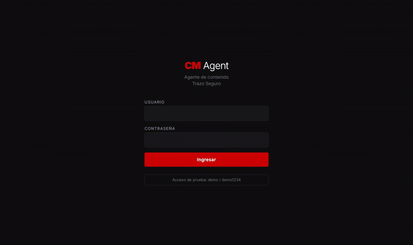
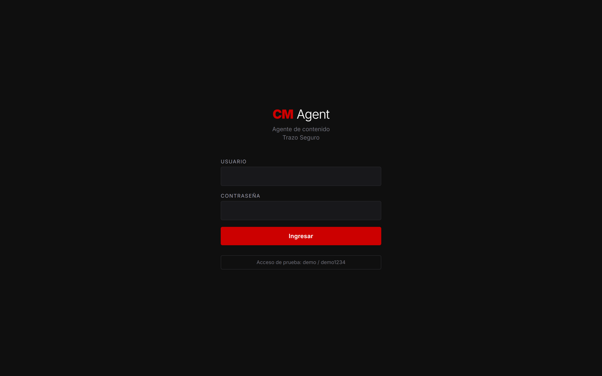
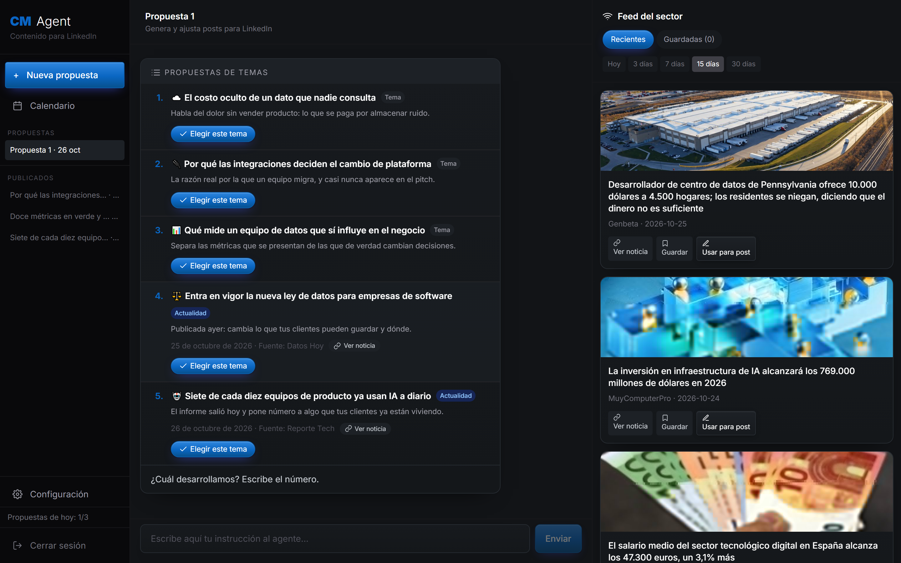
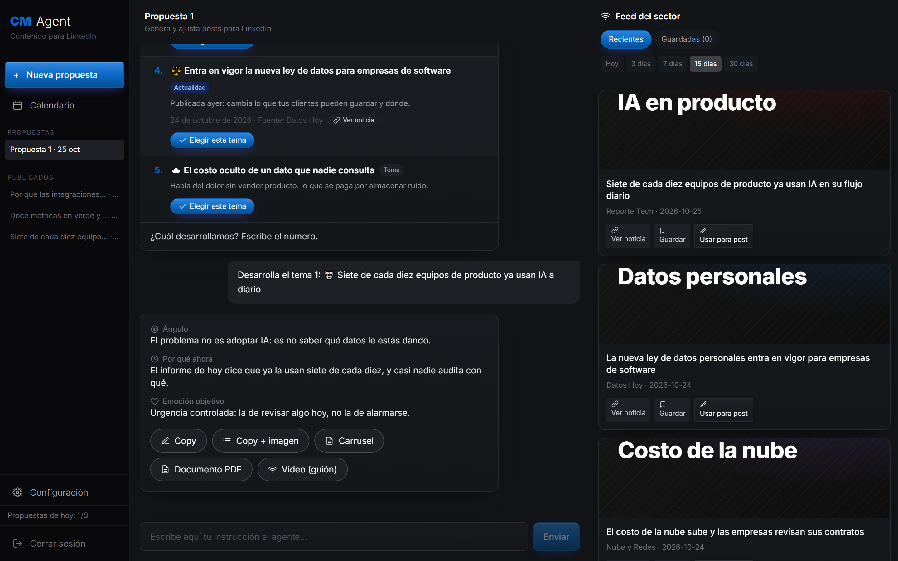
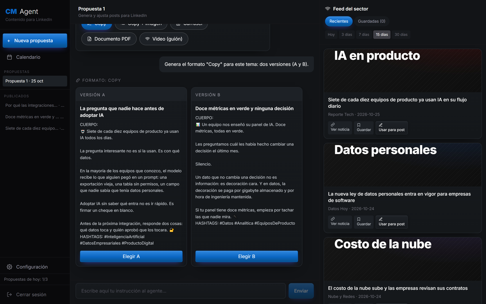
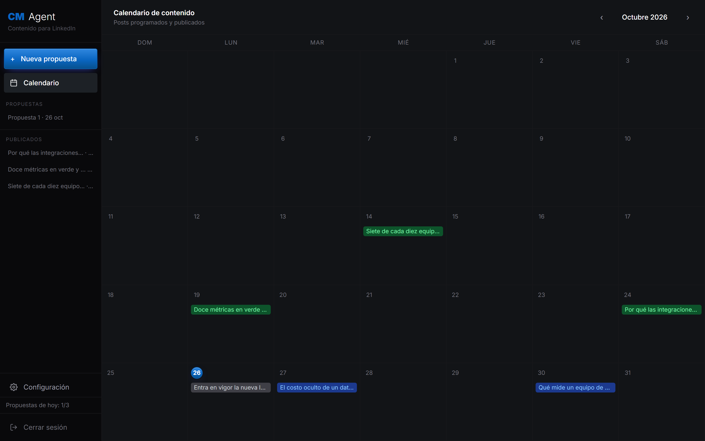
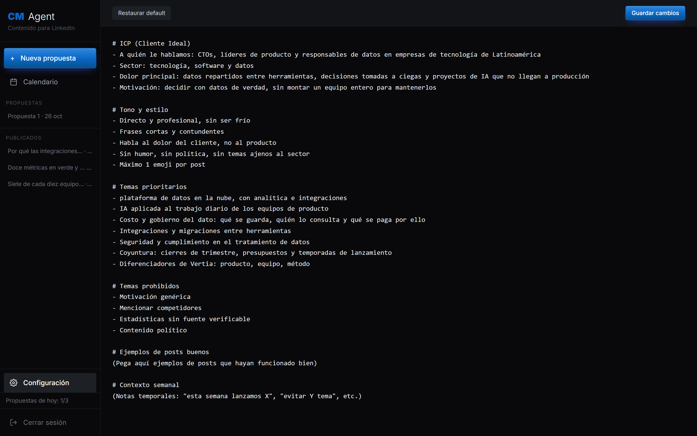

# CM Agent

Agente de community manager con IA para LinkedIn. Acompaña de la idea al post
publicable en cuatro fases, consulta la actualidad del sector mientras propone, y
aprende del uso: cada elección del analista orienta las siguientes propuestas sin
que nadie configure nada.



> Las imágenes de este README se graban contra la demo, con una marca ficticia,
> y se regeneran con `node scripts/capturas.mjs` y `node scripts/demo-gif.mjs`:
> así no envejecen y nunca muestran datos de un cliente real.

---

## Entrega del proyecto final

| | |
|---|---|
| **Aplicación publicada** | **<https://cm-agent-tfm-production.up.railway.app>** |
| **Usuario de prueba** | `demo` |
| **Contraseña de prueba** | `demo1234` |
| **Repositorio** | <https://github.com/gopar-ai/cm-agent-tfm> |
| **Presentación** | [`docs/slides.md`](docs/slides.md) |
| **Vídeo** | _(pendiente de publicar)_ |
| **Documentación técnica** | [`docs/`](docs/) — especificación, requisitos, diseño, seguridad, pruebas |

Las credenciales también aparecen escritas en la propia pantalla de acceso: no
hace falta volver aquí para entrar.

La versión publicada corre en **modo de demostración**: el agente responde con un
guion local en vez de llamar al modelo, así que se puede recorrer el flujo
completo sin gastar nada y sin configurar nada. El código es el mismo; lo único
que cambia es de dónde sale la respuesta, y la aplicación lo declara en la
cabecera `X-Agent-Source`.

---

## Qué problema resuelve

Una empresa B2B con ciclo de venta largo necesita publicar en LinkedIn de forma
constante, y de eso se encarga una analista de marketing, no un equipo de
contenido. Siempre se topa con lo mismo: decidir **de qué** publicar cuesta más
que escribirlo; sin seguir la actualidad del sector el contenido queda
intemporal; y cada herramienta de IA genérica obliga a volver a explicar a quién
le hablamos, con qué tono y qué no se dice.

CM Agent es un agente especializado en una marca, que sabe todo eso de entrada y
que **registra lo que funciona** para acertar más la próxima vez.

## Cómo funciona

```
Analista (chat)
     │
     ▼
Claude Sonnet 4.6 · con búsqueda web
     │
     ├─► Fase 1 · Temas        5 propuestas: fondo del sector + actualidad con fecha verificada
     ├─► Fase 2 · Ángulo       gancho, por qué ahora, emoción objetivo
     ├─► Fase 3 · Versiones    A/B por formato, 3 titulares cada una
     └─► Fase 4 · Ajustes      sobre la versión elegida, sin empezar de nuevo
     │
     ▼
Panel editable ──► Calendario de contenido
     │
     └─► cada elección alimenta la memoria de preferencias ──┐
                                                            │
         las siguientes propuestas ya nacen con ese estilo ◄─┘
```

En paralelo, un feed de noticias del sector (RSS + búsqueda con Claude Haiku 4.5)
acompaña al chat para detectar oportunidades.

## Funcionalidades

- **Flujo en cuatro fases** — temas, ángulo, versiones A/B, ajustes. El agente no
  pregunta qué quieres: entrega lo que toca en cada paso.
- **Cinco formatos con estructura propia** — copy, copy + imagen (con el prompt
  para generarla), carrusel, documento PDF y guion de video.
- **Actualidad con fecha verificada** — solo entra como "actualidad" lo publicado
  hoy o ayer, comparando la fecha de forma literal; el resto se convierte en tema
  de fondo en vez de forzarse.
- **Memoria silenciosa** — aprende formato, versión y estilo de titular
  preferidos, y los aplica sin mencionarlo. A partir de tres elecciones: con
  menos, el patrón sería ruido.
- **Feed de noticias del sector** — RSS de medios + búsqueda web, con caché en
  memoria y en disco para no repetir la búsqueda del día.
- **Calendario de contenido** — borradores, programados y publicados.
- **Varias propuestas en paralelo** — nombrables, fijables, ordenadas por última
  actividad.
- **Contexto de marca editable** — ICP, tono, temas prioritarios y prohibidos, se
  editan desde la propia aplicación.
- **Modo de demostración** — el flujo completo funciona sin clave de API.
- **Acceso con sesión** — contraseña en hash, límite de intentos y cookie que el
  navegador no puede leer.
- **Costo acotado** — presupuesto diario de llamadas al modelo, límite por minuto
  y techo por petición. Al agotarse el presupuesto, el agente sigue atendiendo
  con el guion de demostración en vez de quedarse muerto.

## Cómo se ve

Las cuatro fases, en orden, tal como las recorre la analista.

### 1 · Entrar



La demo publicada muestra el usuario de prueba debajo del formulario: quien
llega a evaluarla no tiene que buscar nada.

### 2 · El agente propone, sin que nadie se lo pida



Cinco temas al abrir una propuesta. Los de **actualidad** llevan medio, fecha y
enlace; los de **fondo** son los asuntos que siempre funcionan en el sector. A
la derecha, el feed del sector, para detectar oportunidades sin salir de la
herramienta.

### 3 · El ángulo, antes de escribir una línea



Tres líneas —ángulo, por qué ahora, emoción objetivo— y los cinco formatos.
Corregir el rumbo aquí es barato; hacerlo después de leer un post entero, no.

### 4 · Dos versiones para comparar



Ganchos realmente distintos, tres titulares cada una, y la estructura propia del
formato elegido. **Elegir es la interfaz:** cada elección alimenta la memoria de
preferencias.

### Y lo que sostiene el trabajo diario

| Calendario de contenido | Contexto de marca editable |
|---|---|
|  |  |
| Borradores, programados y publicados | ICP, tono y temas prohibidos, sin tocar el código |

## Stack

| | |
|---|---|
| **Lenguaje** | TypeScript (modo estricto) |
| **Framework** | Next.js 16 · App Router · React 19 |
| **Estilos** | Tailwind CSS 4 |
| **IA** | Claude Sonnet 4.6 (agente) y Claude Haiku 4.5 (feed), con búsqueda web nativa |
| **Validación** | Zod, en la configuración y en la entrada de la API |
| **Sesión** | JWT en cookie `httpOnly`; contraseña en hash scrypt |
| **Pruebas** | Vitest (383) + Playwright (10 × 2 perfiles) |
| **Entorno** | Node.js 24 · Docker multietapa · GitHub Actions · Railway |
| **Persistencia** | `localStorage` del navegador (decisión de diseño, no carencia: [docs/03](docs/03-diseno.md)) |

## Instalación

Requisitos: **Node.js 24 o superior**.

```bash
git clone https://github.com/gopar-ai/cm-agent-tfm.git
cd cm-agent-tfm
npm install
npm run dev
```

Abrir <http://localhost:3000> y entrar con **`demo` / `demo1234`**.

No hace falta configurar nada ni tener clave de API: fuera de producción la
aplicación rellena credenciales de desarrollo y el agente responde con su guion
de demostración. Se recorre el flujo completo tal cual.

### Con el agente real

Crear `.env.local` con la clave de Anthropic:

```bash
cp .env.example .env.local
# editar .env.local y poner ANTHROPIC_API_KEY=sk-ant-...
npm run dev
```

### Con Docker

```bash
docker build -t cm-agent .
docker run -p 3000:3000 \
  -e APP_USERNAME=demo \
  -e APP_PASSWORD=demo1234 \
  -e JWT_SECRET="$(openssl rand -hex 32)" \
  -e DEMO_MODE=true \
  cm-agent
```

La receta completa de despliegue, con todas las variables, está en
[docs/08-despliegue.md](docs/08-despliegue.md).

## Comandos

| Comando | Qué hace |
|---|---|
| `npm run dev` | Servidor de desarrollo |
| `npm run build` / `npm start` | Construcción y arranque de producción |
| `npm test` | 383 pruebas unitarias y de integración (~5 s) |
| `npm run test:cov` | Las mismas, con cobertura y umbrales que hacen fallar |
| `npm run test:e2e` | Recorrido en navegador real, en escritorio y celular |
| `npm run lint` / `npm run typecheck` | Análisis estático y tipos |
| `npm run verify` | Lint + tipos + pruebas con cobertura |
| `npm run hash-password -- "tu contraseña"` | Genera el valor de `APP_PASSWORD_HASH` |

## Estructura

```
cm-agent/
├── app/                        Next.js App Router
│   ├── api/
│   │   ├── auth/login/         acceso: límite por IP, hash, cookie firmada
│   │   ├── auth/logout/
│   │   ├── chat/               conversación: validación, presupuesto, modelo o guion
│   │   ├── cron/refresh-news/  refresco programado del feed
│   │   ├── health/             estado del servicio
│   │   └── news/               feed con caché en memoria y disco
│   ├── calendar/               calendario de contenido
│   ├── dashboard/              chat y configuración del contexto
│   └── login/
│
├── components/                 tarjetas de temas, ángulo, versiones A/B, feed…
│
├── lib/
│   ├── agent-messages.ts       contrato de mensajes entre interfaz y agente
│   ├── anthropic.ts            prompt del sistema y streaming del modelo
│   ├── agent-context.ts        contexto de marca editable
│   ├── agent-memory.ts         memoria de preferencias editoriales
│   ├── brand.ts                identidad de la marca, por configuración
│   ├── calendar-storage.ts     calendario, borradores y publicados
│   ├── chat-storage.ts         conversaciones guardadas
│   ├── day-key.ts              corte del día en la zona de la operación
│   ├── demo-agent.ts           guion de demostración, sin API
│   ├── env.ts                  configuración validada al arrancar
│   ├── local-store.ts          acceso al almacenamiento del navegador
│   ├── model-budget.ts         presupuesto diario de llamadas al modelo
│   ├── news*.ts                feed: fuentes, RSS, búsqueda, caché
│   ├── post-parser.ts          lectura de los bloques que devuelve el modelo
│   ├── prompt-safety.ts        texto no confiable que entra al prompt
│   ├── rate-limit.ts           límite de peticiones por clave
│   ├── schemas.ts              techos de la entrada de la API
│   └── security.ts             hash, comparación segura, validación de URL
│
├── tests/                      383 pruebas unitarias y de integración
│   ├── api/                    rutas con dobles
│   └── helpers/                doble de navegador y arranque común
├── e2e/                        recorrido en navegador real
├── docs/                       documentación técnica (ver abajo)
├── scripts/
│   ├── hash-password.mjs       generador del hash de contraseña
│   ├── capturas.mjs            capturas del README, desde la demo
│   └── demo-gif.mjs            animación del README, desde la demo
├── Dockerfile                  imagen multietapa, usuario sin privilegios
├── proxy.ts                    middleware de sesión
└── .github/workflows/ci.yml    integración continua
```

## Documentación técnica

| Documento | Qué contiene |
|---|---|
| [01 · Especificación](docs/01-especificacion.md) | Problema, actores, 15 historias de usuario con criterios de aceptación y prioridad, ambigüedades resueltas |
| [02 · Requisitos](docs/02-requisitos.md) | 23 requisitos no funcionales con umbral medible y cómo se comprueban |
| [03 · Diseño](docs/03-diseno.md) | Arquitectura, siete decisiones con sus alternativas y su costo, riesgos, deuda técnica reconocida |
| [04 · Seguridad](docs/04-seguridad.md) | Auditoría propia: ocho hallazgos corregidos, recorrido de OWASP Top 10 y OWASP LLM, riesgo residual |
| [05 · Pruebas](docs/05-pruebas.md) | Estrategia, reparto por niveles, trazabilidad historia-prueba, cobertura y los defectos que encontraron |
| [06 · Cotejo](docs/06-cotejo-master.md) | Qué pide el máster y dónde está cada cosa |
| [07 · Trabajo con IA](docs/07-trabajo-con-ia.md) | Modelo por tarea, control de costos, y cómo se usó la IA para construirlo |
| [08 · Despliegue](docs/08-despliegue.md) | Variables, Docker, Railway, qué vigilar |

## Calidad

| | |
|---|---|
| **Pruebas** | 383 unitarias y de integración · 10 × 2 perfiles = 20 en navegador real |
| **Cobertura** | 98 % sentencias · 97 % funciones · 99 % líneas · 90 % ramas |
| **Umbrales** | La suite falla si la cobertura baja de 85/90/85/80 |
| **Análisis estático** | 0 errores |
| **Integración continua** | Lint · tipos · pruebas · construcción · navegador · contenedor |

El proyecto partía de una aplicación que ya funcionaba en producción pero no
tenía ninguna prueba, ni integración continua, ni contenedor, ni validación de
configuración, ni cabeceras de seguridad. Lo que se hizo fue llevarla al punto en
que se puede sostener y auditar: ocho hallazgos de seguridad corregidos y once
defectos de comportamiento que las pruebas destaparon, cada uno con su prueba de
regresión. El detalle está en [docs/04](docs/04-seguridad.md) y
[docs/05](docs/05-pruebas.md).

## Licencia

MIT. Ver [LICENSE](LICENSE).
